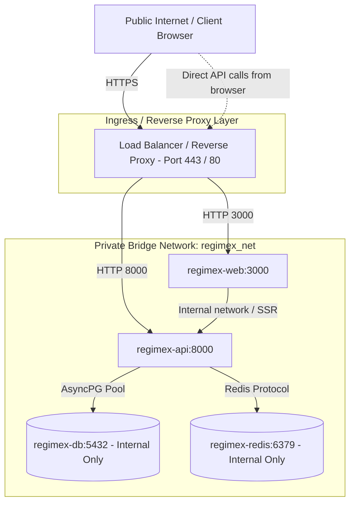

# RegimeX — Deployment & Production Infrastructure Guide

> **V24 Commit 02 — Production Infrastructure Configuration**  
> Operational runbook and deployment guide covering local development, containerized production stacks, secret management, port binding reliability, database lifecycle, and operational diagnostics.

---

## Table of Contents

1. [Local Development vs. Production Configuration](#1-local-development-vs-production-configuration)
2. [Production Environment Variables & Validation](#2-production-environment-variables--validation)
3. [Image Build and Release Procedure](#3-image-build-and-release-procedure)
4. [Startup, Port Binding & Health Policies](#4-startup-port-binding--health-policies)
5. [Database Configuration & Migrations](#5-database-configuration--migrations)
6. [Backup and Restore Procedures](#6-backup-and-restore-procedures)
7. [Resource-Sizing Guidance & Limits](#7-resource-sizing-guidance--limits)
8. [Secrets & Key Management](#8-secrets--key-management)
9. [Network Security & Topology](#9-network-security--topology)
10. [Graceful Shutdown & Lifecycle](#10-graceful-shutdown--lifecycle)
11. [Troubleshooting No-Open-Port Failures](#11-troubleshooting-no-open-port-failures)
12. [Troubleshooting Memory-Limit Failures](#12-troubleshooting-memory-limit-failures)
13. [Post-Deployment Verification Steps](#13-post-deployment-verification-steps)
14. [Rollback Procedure](#14-rollback-procedure)

---

## 1. Local Development vs. Production Configuration

RegimeX establishes clear configuration boundaries across three operating modes:

| Dimension | Local Development (`development`) | Automated Testing (`test`) | Production Deployment (`production`) |
|---|---|---|---|
| **Compose File** | `infra/docker-compose.yml` | None (in-memory SQLite / mocked) | `infra/docker-compose.yml` + `infra/docker-compose.prod.yml` |
| **Env File Source** | `apps/api/.env` via `env_file` | `conftest.py` injection | Platform Secrets / Host Environment (no committed `.env`) |
| **Database Port (5432)** | Bound to `127.0.0.1:5432` | Not required | **Unpublished** (private `regimex_net` bridge only) |
| **Redis Port (6379)** | Bound to `127.0.0.1:6379` | Not required | **Unpublished** (private `regimex_net` bridge only) |
| **API Port (8000)** | Bound to `127.0.0.1:8000` | Dynamic test socket | Bound to `${API_BIND_IP:-127.0.0.1}:${PORT:-8000}` |
| **Web Port (3000)** | Bound to `127.0.0.1:3000` | Mock server | Bound to `${WEB_BIND_IP:-0.0.0.0}:${WEB_PORT:-3000}` |
| **Database Credentials** | Default development allowed | In-memory dummy allowed | **Strictly enforced** — placeholder strings (`changeme`) rejected |
| **JWT Signing Key** | Default fallback permitted | Fixed test key permitted | **Strictly enforced** — ≥32 random characters required |
| **CORS Origins** | `http://localhost:3000` | Permissive for tests | **Strictly enforced** — explicit origins required; `*` rejected |
| **API Workers** | 1 worker | In-process | 1 worker per container (scale horizontally via replicas) |
| **Log Format** | Human-readable text (`text`) | Text | Structured JSON lines (`json`) |
| **Migrations** | Manual (`alembic upgrade head`) | Auto/In-memory | **One-off pre-deployment step** (never run inside workers) |

### Local Development Stack Command

```bash
docker compose -f infra/docker-compose.yml up -d
```

### Production Stack Command

```bash
# Validating production overlay before deployment
docker compose -f infra/docker-compose.yml -f infra/docker-compose.prod.yml config

# Starting production stack with required secrets provided in environment
docker compose -f infra/docker-compose.yml -f infra/docker-compose.prod.yml up -d
```

---

## 2. Production Environment Variables & Validation

All backend configuration is defined in [`app.core.config.Settings`](file:///apps/api/app/core/config.py). Variables are loaded from the environment with the `REGIMEX_` prefix, while recognizing standard cloud platform aliases.

### Required Production Variables

| Variable | Cloud Alias | Description | Validation Rule |
|---|---|---|---|
| `REGIMEX_ENV` | — | Execution environment | Must be `production` |
| `REGIMEX_SECRET_KEY` | `AUTH_JWT_SECRET`, `SECRET_KEY` | JWT signing secret | Must be ≥32 random characters; rejects placeholder patterns |
| `REGIMEX_DATABASE_URL` | `DATABASE_URL` | PostgreSQL async connection string | Must start with `postgresql+asyncpg://` (auto-normalizes `postgresql://`); rejects default `changeme` credentials |
| `REGIMEX_ALLOWED_ORIGINS` | `CORS_ALLOWED_ORIGINS` | Comma-separated allowed CORS origins | Explicit domain names; wildcard `*` is strictly rejected |
| `NEXT_PUBLIC_API_URL` | `NEXT_PUBLIC_API_BASE_URL` | Browser-accessible API URL | Must be client-resolvable HTTP/HTTPS; internal container hostnames (`api`, `db`) are rejected |
| `PORT` | `REGIMEX_PORT`, `API_PORT` | Port the API binds to | Integer between 1 and 65535 (default: `8000`) |

### Optional / Tunable Variables

| Variable | Cloud Alias | Default | Description |
|---|---|---|---|
| `REGIMEX_REDIS_URL` | `REDIS_URL` | `redis://localhost:6379/0` | Redis connection URL |
| `REGIMEX_CELERY_BROKER_URL` | `CELERY_BROKER_URL` | `redis://localhost:6379/1` | Celery broker URL |
| `REGIMEX_CELERY_RESULT_BACKEND` | `CELERY_RESULT_BACKEND` | `redis://localhost:6379/2` | Celery backend URL |
| `DATABASE_POOL_SIZE` | `REGIMEX_DATABASE_POOL_SIZE` | `10` | SQLAlchemy connection pool size (1–100) |
| `DATABASE_MAX_OVERFLOW` | `REGIMEX_DATABASE_MAX_OVERFLOW` | `20` | Max overflow connections beyond pool size |
| `DATABASE_POOL_TIMEOUT` | `REGIMEX_DATABASE_POOL_TIMEOUT` | `30` | Seconds before timing out on connection checkout |
| `DATABASE_POOL_RECYCLE` | `REGIMEX_DATABASE_POOL_RECYCLE` | `1800` | Connection recycling interval in seconds (30m) |
| `DATABASE_CONNECT_TIMEOUT` | `REGIMEX_DATABASE_CONNECT_TIMEOUT` | `10` | Database handshake timeout in seconds |
| `DATABASE_STATEMENT_TIMEOUT_MS` | `REGIMEX_DATABASE_STATEMENT_TIMEOUT_MS` | `30000` | Database query timeout in milliseconds (30s) |
| `REGIMEX_LOG_FORMAT` | `LOG_FORMAT` | `json` | `json` (structured, production) or `text` (local) |
| `REGIMEX_LOG_LEVEL` | `LOG_LEVEL` | `INFO` | `DEBUG`, `INFO`, `WARNING`, `ERROR`, `CRITICAL` |
| `REGIMEX_AI_PROVIDER` | `AI_PROVIDER` | `mock` | `mock` (deterministic local) or `openai` |
| `REGIMEX_AI_API_KEY` | `AI_API_KEY` | None | API key for external AI provider (required if `openai`) |
| `REGIMEX_AI_BASE_URL` | `AI_BASE_URL` | None | Base URL for OpenAI-compatible gateways (vLLM, Ollama) |

A complete template is available at [`infra/.env.production.example`](file:///infra/.env.production.example).

---

## 3. Image Build and Release Procedure

Images are built using standard multi-stage Dockerfiles designed for layer caching, minimal runtime attack surface, and unprivileged user execution.

### Building API Image

Run from the repository root:

```bash
docker build \
  -f infra/docker/api.Dockerfile \
  -t regimex-api:latest \
  -t regimex-api:v24.2 \
  .
```

### Building Web Image

Run from the repository root:

```bash
docker build \
  -f infra/docker/web.Dockerfile \
  -t regimex-web:latest \
  -t regimex-web:v24.2 \
  .
```

### Build & Release Verification Checklist

1. **Verify non-root user**:
   ```bash
   docker run --rm regimex-api:latest id
   # uid=1001(regimex) gid=1001(regimex)
   docker run --rm regimex-web:latest id
   # uid=1001(nextjs) gid=1001(nodejs)
   ```
2. **Verify build exclusion compliance**:
   Confirm that `.dockerignore` prevented `.git`, `tests/`, `node_modules/`, and `.env` from leaking into image layers:
   ```bash
   docker run --rm regimex-api:latest ls -la /app
   # Expect: app, alembic, alembic.ini (no tests, no .env)
   ```

---

## 4. Startup, Port Binding & Health Policies

### Port Binding & Host Guarantees

Both services are configured to bind to `0.0.0.0` inside containers and respect dynamically assigned platform ports:
- **API**: Runs `uvicorn app.main:app --host 0.0.0.0 --port ${PORT:-8000} --workers 1 --no-access-log`.
- **Web**: Runs `node server.js` which automatically binds to `HOSTNAME=0.0.0.0` and reads `PORT` (default `3000`).

### Liveness vs. Readiness Probes

RegimeX strictly distinguishes process liveness from operational readiness:

| Endpoint | Probe Type | Description | Failure Behavior |
|---|---|---|---|
| `GET /health` | **Liveness** | Lightweight process-alive check. Returns `{"status": "ok"}` in <5ms without touching external services. | If process hangs or exits, container is restarted. |
| `GET /ready` | **Readiness** | Evaluates whether the API is capable of serving traffic. Checks application state and tests database connectivity (`SELECT 1`) with a 2.0s bounded timeout. | Returns HTTP 503 `{"status": "not_ready", "checks": {"database": "unavailable"}}`. Ingress removes instance from traffic pool. |
| `GET /metrics` | **Telemetry** | Prometheus metric scraper. Reports request durations, error rates, and system metrics. | Bounded scrape timeout; no external calls. |

> [!IMPORTANT]
> **Health Check Guarantees**: Health endpoints never run full model inference, never download remote market data, never train HMMs, and never leak credentials or stack traces in responses.

---

## 5. Database Configuration & Migrations

### Managed Database vs. Containerized Database

For production deployments, a managed PostgreSQL + TimescaleDB instance is strongly recommended (e.g., Timescale Cloud, AWS RDS with TimescaleDB extension, or Supabase).

### Connection Pooling Best Practices

- Set `DATABASE_POOL_SIZE` according to your orchestrator's concurrency:
  $$\text{Total Connections} = \text{API Replicas} \times (\text{POOL\_SIZE} + \text{MAX\_OVERFLOW})$$
  Ensure total connections stay within your PostgreSQL `max_connections` limit.
- `DATABASE_POOL_RECYCLE=1800` ensures idle connections are refreshed every 30 minutes, preventing silent drops by cloud load balancers or firewalls.
- `DATABASE_STATEMENT_TIMEOUT_MS=30000` prevents slow analytical queries from holding pool slots indefinitely.

### Migration Execution Procedure

Database migrations use [Alembic](https://alembic.sqlalchemy.org/).  
**Rule**: Migrations are never executed automatically inside API runtime workers. Run migrations as a dedicated pre-deployment step.

#### Step 1: Check Current Database Revision

```bash
docker compose -f infra/docker-compose.yml -f infra/docker-compose.prod.yml \
  run --rm api alembic current
```

#### Step 2: Apply Migrations (Pre-Deployment Phase)

```bash
docker compose -f infra/docker-compose.yml -f infra/docker-compose.prod.yml \
  run --rm api alembic upgrade head
```

#### Step 3: Verify Revision Match

```bash
docker compose -f infra/docker-compose.yml -f infra/docker-compose.prod.yml \
  run --rm api alembic heads
```

---

## 6. Backup and Restore Procedures

> [!WARNING]
> **Persistent Volumes Are Not Backups**: Named Docker volumes (`postgres_data`) preserve state across container restarts and replacements on the same host, but do NOT protect against disk failure, volume corruption, accidental deletion (`docker compose down -v`), or regional outages.

### Supported Database Backup Procedure

Perform logical dumps using `pg_dump` with custom directory or compressed format:

```bash
# Set timestamp and backup destination
TIMESTAMP=$(date +%Y%m%d_%H%M%S)
BACKUP_FILE="backup_regimex_${TIMESTAMP}.sql.gz"

# Execute compressed backup from running db container
docker compose -f infra/docker-compose.yml -f infra/docker-compose.prod.yml \
  exec -T db pg_dump -U regimex regimex_prod | gzip > "${BACKUP_FILE}"

# Secure backup archive
chmod 600 "${BACKUP_FILE}"
```

For offsite retention, copy `${BACKUP_FILE}` to object storage (AWS S3, Google Cloud Storage) with encryption and retention lifecycle policies enabled.

### Database Restore Procedure

To restore into a clean database instance:

```bash
# 1. Stop API traffic to prevent concurrent writes
docker compose -f infra/docker-compose.yml -f infra/docker-compose.prod.yml stop api web

# 2. Re-create clean database
docker compose -f infra/docker-compose.yml -f infra/docker-compose.prod.yml exec -T db \
  psql -U regimex -c "DROP DATABASE IF EXISTS regimex_prod;"
docker compose -f infra/docker-compose.yml -f infra/docker-compose.prod.yml exec -T db \
  psql -U regimex -c "CREATE DATABASE regimex_prod OWNER regimex;"

# 3. Restore schema and data
gunzip -c "${BACKUP_FILE}" | docker compose -f infra/docker-compose.yml -f infra/docker-compose.prod.yml \
  exec -T db psql -U regimex -d regimex_prod

# 4. Run Alembic upgrade check to verify schema consistency
docker compose -f infra/docker-compose.yml -f infra/docker-compose.prod.yml \
  run --rm api alembic upgrade head

# 5. Restart application services
docker compose -f infra/docker-compose.yml -f infra/docker-compose.prod.yml start api web
```

---

## 7. Resource-Sizing Guidance & Limits

### Verified Component Sizing

| Service | Recommended CPU Limit | Recommended Memory Limit | Minimum Memory Reservation | Concurrency Model |
|---|---|---|---|---|
| **API (`regimex-api`)** | 2.0 vCPU | 1024 MiB (1 GiB) | 256 MiB | 1 worker, async I/O |
| **Web (`regimex-web`)** | 1.5 vCPU | 768 MiB | 192 MiB | Node.js event loop |
| **Database (`regimex-db`)** | 2.0 vCPU | 2048 MiB (2 GiB) | 512 MiB | Multi-process PostgreSQL |
| **Redis (`regimex-redis`)** | 1.0 vCPU | 512 MiB | 128 MiB | In-memory with `maxmemory 256mb` |

### Sizing Notes by Hosting Topology

1. **Local Compose**: Limits defined in `infra/docker-compose.prod.yml` under `deploy.resources` are enforced by Compose v2 when run in production mode.
2. **Kubernetes**: Translate `limits` and `reservations` directly to Pod `resources.limits` and `resources.requests`.
3. **Managed PaaS (Render, Fly.io, Railway)**:
   - **Render**: Starter instances provide 512 MiB RAM. Under `--workers 1`, the API baseline footprint is ~140–180 MiB. However, concurrent mathematical computations (Statsmodels / Scikit-Learn regime fitting) can briefly peak at 350–450 MiB. For high-volume production, choose instances with ≥1 GiB RAM.

---

## 8. Secrets & Key Management

### Production Secret Hierarchy

1. **JWT Secret (`REGIMEX_SECRET_KEY`)**:
   - Signs user access tokens. Must be generated using cryptographic entropy:
     ```bash
     python -c "import secrets; print(secrets.token_hex(32))"
     ```
   - Rotating this secret invalidates all existing active user sessions.
2. **Database Credentials**:
   - Sourced via `REGIMEX_DATABASE_URL`. Never use default passwords (`changeme`).
   - The password is masked (`***`) by `Settings.sanitized_database_url()` before being emitted to stdout logs or diagnostics.
3. **External Provider Keys**:
   - `REGIMEX_AI_API_KEY`: Kept exclusively in secret managers. Never committed to version control.
   - Defaults to `REGIMEX_AI_PROVIDER=mock` so services operate safely out of the box without requiring external API keys.

---

## 9. Network Security & Topology



### Security Rules

1. **No Public Database or Cache Exposure**: In `infra/docker-compose.prod.yml`, the `ports` mappings for `db` and `redis` are stripped using `ports: !reset []`. PostgreSQL and Redis communicate exclusively over `regimex_net`.
2. **TLS Termination**: All public traffic terminates at the load balancer or ingress layer. The API detects TLS termination via the `X-Forwarded-Proto: https` header and automatically enforces `Strict-Transport-Security` headers.
3. **CORS Boundary**: Only exact browser origins configured in `REGIMEX_ALLOWED_ORIGINS` are permitted to execute cross-origin browser requests.

---

## 10. Graceful Shutdown & Lifecycle

1. **SIGTERM Signal Handling**: When orchestrators signal container shutdown (`docker stop`, Kubernetes pod termination), the process is granted a grace period (default 30 seconds).
2. **In-Flight Request Bounding**: Uvicorn finishes active HTTP requests while refusing new inbound requests.
3. **Database Engine Disposal**: The application lifespan executes `await dispose_engine()` with a 5.0-second timeout to close idle connection pool sockets cleanly without hanging.
4. **Redis Connections**: Worker queues disconnect cleanly upon signal receipt.

---

## 11. Troubleshooting No-Open-Port Failures

If an orchestrator reports `no open ports detected` or `service failed to bind port`:

| Check | Cause | Resolution |
|---|---|---|
| **Host binding** | Process listening on `127.0.0.1` instead of `0.0.0.0` | Verify API Dockerfile runs with `--host 0.0.0.0` and web runs with `HOSTNAME=0.0.0.0`. |
| **Platform PORT override** | App listening on hardcoded port 8000 when platform assigned a random port | Ensure startup command uses `--port ${PORT:-8000}`. `Settings.api_port` accepts `PORT` via `AliasChoices`. |
| **Blocking startup hook** | Code before server listen blocks on network calls (e.g. database ping or remote API download) | RegimeX startup lifespan does not block on external networks; all provider registries are in-memory. |
| **Crash before port bind** | Validation error on missing production environment variable | Check container logs: `docker logs regimex-api`. Look for sanitized `ValidationError` indicating missing `REGIMEX_SECRET_KEY` or `REGIMEX_DATABASE_URL`. |

---

## 12. Troubleshooting Memory-Limit Failures

If a container is terminated with exit code 137 (OOM Killer) or the platform reports memory usage above quota:

### Diagnosis Procedure

1. **Check Container Memory Usage**:
   ```bash
   docker stats --no-stream regimex-api regimex-web
   ```
2. **Inspect Process Memory Inside Container**:
   ```bash
   docker compose -f infra/docker-compose.yml -f infra/docker-compose.prod.yml \
     exec api python -c "import os, resource; print(resource.getrusage(resource.RUSAGE_SELF).ru_maxrss, 'KB RSS')"
   ```

### Common Memory Causes & Resolutions

- **Worker Count**: Never run multiple Uvicorn workers (`--workers > 1`) inside a single container instance. Numerical libraries (NumPy, SciPy, Pandas, Scikit-Learn) each consume memory per process. Scale by deploying additional container replicas instead.
- **Connection Pool Size**: Keep `DATABASE_POOL_SIZE` bounded (default: `10`, max overflow: `20`).
- **Telemetry Snapshots**: RegimeX bounds historical observability snapshots in memory via `REGIMEX_OBSERVABILITY_HISTORY_LIMIT=50`.
- **Request Body Limits**: The security boundary rejects payloads exceeding `REGIMEX_MAX_REQUEST_BODY_BYTES=10485760` (10 MiB) before memory allocation.

---

## 13. Post-Deployment Verification Steps

Execute these tests immediately following any production deployment or configuration change:

### Step 1: Liveness Check

```bash
curl -fsS https://api.yourdomain.com/health | python -m json.tool
```
*Expected*: `{"status": "ok"}` with HTTP 200.

### Step 2: Readiness Check

```bash
curl -fsS https://api.yourdomain.com/ready | python -m json.tool
```
*Expected*: HTTP 200 with:
```json
{
  "status": "ready",
  "checks": {
    "application": "ok",
    "database": "ok"
  }
}
```

### Step 3: Web Application Shell Verification

```bash
curl -I https://app.yourdomain.com/
```
*Expected*: HTTP 200 with standard security headers (`X-Frame-Options: DENY`, `X-Content-Type-Options: nosniff`).

### Step 4: Metrics Scrape Verification

```bash
curl -fsS https://api.yourdomain.com/metrics | grep regimex_api_requests_total
```

---

## 14. Rollback Procedure

In the event of an operational failure, regression, or database schema incompatibility:

### Step 1: Roll Back Application Containers

Re-deploy the previous known-healthy container image tag:

```bash
# Point deployment to previous release tag (e.g., v24.1)
export IMAGE_TAG=v24.1

docker compose -f infra/docker-compose.yml -f infra/docker-compose.prod.yml up -d
```

### Step 2: Roll Back Database Schema (If Necessary)

If a schema migration was applied and needs reversion:

```bash
# Check current migration revision
docker compose -f infra/docker-compose.yml -f infra/docker-compose.prod.yml \
  run --rm api alembic current

# Downgrade schema by one revision (or to specific target revision ID)
docker compose -f infra/docker-compose.yml -f infra/docker-compose.prod.yml \
  run --rm api alembic downgrade -1
```

### Step 3: Clear Redis Cache (If Schema / Data Format Changed)

```bash
docker compose -f infra/docker-compose.yml -f infra/docker-compose.prod.yml \
  exec redis redis-cli flushdb
```

### Step 4: Re-Verify Post-Deployment Checks

Re-execute [Section 13](#13-post-deployment-verification-steps) to ensure services report `ready` and `ok`.
